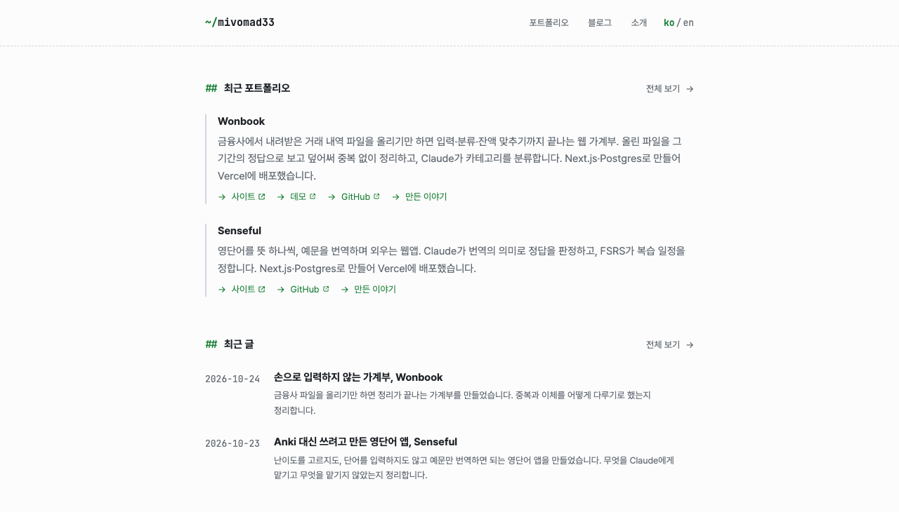
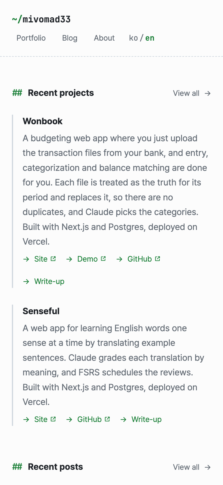
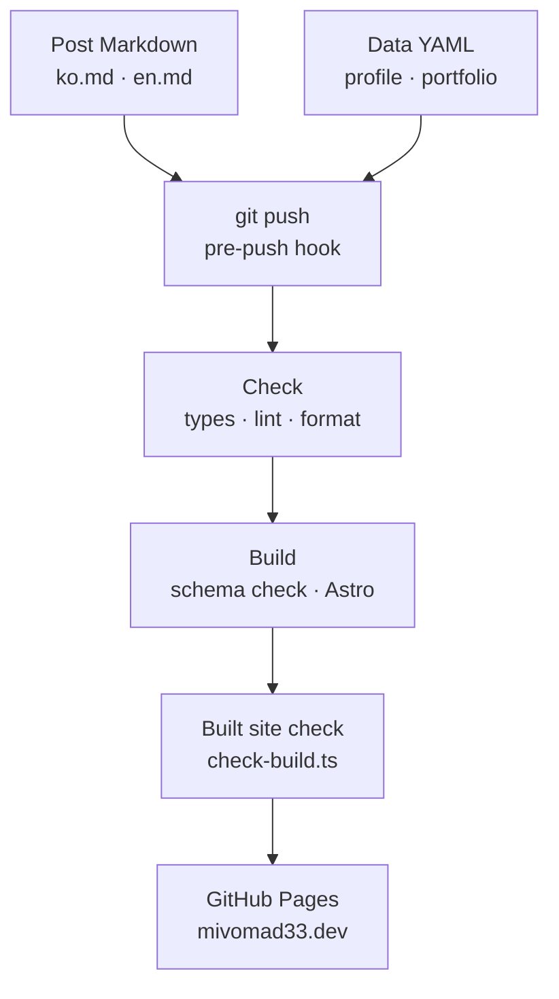

<div align="center">


<h1>mivomad33.dev</h1>

<p>A personal site with my profile, portfolio and blog, in Korean and English.</p>

[](https://github.com/mivomad33/mivomad33.github.io/actions/workflows/deploy.yml)
[](https://mivomad33.dev)
[](https://astro.build)
[](https://www.typescriptlang.org)
[](https://tailwindcss.com)
[](LICENSE)

[Site](https://mivomad33.dev) · [Features](#features) · [How it works](#how-it-works) · [Quick start](#quick-start) · [Adding content](#adding-content)

[한국어](README.md) | **English**

</div>

<p align="center">
  
</p>

## About

I built this site to keep what I make (projects, notes on development and business) in one place.
There is no CMS: I edit Markdown and YAML files in this repository and push, and the site is checked, built and deployed to GitHub Pages.

- Home: recent projects and recent posts
- Portfolio: projects listed in a data file, shown as cards
- Blog: post list and post pages (with previous and next post)
- About: profile and contact

## Features

- **Two languages**: every page is built in Korean (`/...`) and English (`/en/...`), and the `ko / en` link in the header goes to the same page in the other language. If a post, portfolio item or profile is missing one language, the build fails and nothing is deployed.
- **Content as files**: a post is a folder with `ko.md` and `en.md`; the profile and portfolio are YAML files. A schema (Zod) checks the format, so a missing field or a typo fails the build.
- **Search engine basics**: every page has description, canonical, OG and Twitter meta tags and per-language alternate links (hreflang). Posts have structured data (`BlogPosting`). There is an OG image per language, a sitemap with language versions, and robots.txt.
- **Checks on the built site**: after the build, a script reads every generated HTML file and checks meta tags, language links, the sitemap, robots.txt and external link markup. If anything is off, nothing is deployed.
- **External link marking**: links that leave the site open in a new tab and get an icon and screen reader text. The same rule applies to Markdown links in posts.
- **Minimal design**: a developer-style look with monospace symbols and dates and a green accent. No horizontal scrolling on desktop or mobile.

## Screenshots

<table>
  <tr>
    <td width="64%"></td>
    <td width="36%"></td>
  </tr>
</table>

<p align="center">
  
  &nbsp;
  
</p>

## How it works



1. When I push a post or data change, the local `pre-push` hook runs `pnpm verify` first and stops the push if it fails.
2. GitHub Actions runs check (`pnpm check`) → build (`pnpm build`) → deploy in order. If a step fails, the next one does not run.
3. The build checks posts and data against the content collection schemas, generates static HTML, and `scripts/check-build.ts` checks the output.
4. Only pushes to main are deployed to GitHub Pages. Other branches are checked and built only.

## Quality checks

- `pnpm check`: type check (`astro check`), ESLint, Prettier format check
- `pnpm build`: build (including schema checks) and the built site check
- `pnpm verify`: runs both in order. It is the same command the pre-push hook runs.
- What the built site check covers: meta tags per page type, every page existing in both languages, hreflang and language switch links pointing to real pages, no page missing from the sitemap, robots.txt rules, OG image sources matching the profile, external link markup
- Packages are installed only once they have been published for at least a day (pnpm's `minimumReleaseAge`), to avoid malicious versions right after release.

## Tech stack

| Area       | Used                                                                  |
| ---------- | --------------------------------------------------------------------- |
| Framework  | Astro 7 (static output), content collections                          |
| Language   | TypeScript 6                                                          |
| Styling    | Tailwind CSS 4, Pretendard, JetBrains Mono                            |
| Markdown   | Astro's built-in processor (Sätteri), Shiki syntax highlighting       |
| Checks     | Zod schemas, `astro check`, ESLint, Prettier, built site check script |
| SEO        | `@astrojs/sitemap`, hand-written robots.txt and meta tags             |
| Deployment | GitHub Actions, GitHub Pages (custom domain)                          |
| Tooling    | pnpm 12, Node 24                                                      |

## Quick start

Requirements: Node 24.16 or later (`.nvmrc`), pnpm 12 (`packageManager` in `package.json`)

```sh
git clone https://github.com/mivomad33/mivomad33.github.io.git
cd mivomad33.github.io
pnpm install      # install dependencies and set up the pre-push hook
pnpm dev          # dev server
pnpm verify       # check and build (same as the pre-push hook)
```

- `pnpm install` runs the `prepare` script, which sets `.githooks/` as the Git hooks folder. If dependencies were already installed and `prepare` was skipped, run `pnpm run prepare` once.
- To preview the built site, run `pnpm preview` after `pnpm build`.

## Adding content

### Posts

Add a Korean `ko.md` and an English `en.md` together in `src/content/blog/<slug>/`. The folder name (slug) becomes the URL (`/blog/<slug>/`, `/en/blog/<slug>/`) and uses lowercase letters, digits and hyphens. Images for the post go in `images/` in the same folder.

```md
---
title: 'Post title'
description: 'One or two sentences shown in lists and search results'
date: 2026-10-24
updated: 2026-10-30 # optional, only after a major edit
---

<body>
```

### Profile and portfolio

- `src/data/profile.yaml`: name, one-line intro, email, links
- `src/data/portfolio.yaml`: name, description and links for each project. Items appear in file order, so add new ones at the top.

Text that differs by language needs both `ko` and `en`. Fields and rules are in [the data file format section of the design doc](docs/design.md#데이터-파일-형식) (Korean).

## Project structure

<details>
<summary>Main folders</summary>

```text
.
├── .github/              # workflow (check, build, deploy) and README images
├── .githooks/            # pre-push check hook
├── docs/                 # planning, design and progress docs
├── public/               # favicon, OG images
├── scripts/
│   └── check-build.ts    # built site check
└── src/
    ├── components/       # shared UI components
    ├── content/blog/     # blog posts (<slug>/ko.md, en.md)
    ├── data/             # profile and portfolio data
    ├── layouts/          # shared layout
    ├── lib/              # site settings, languages, meta tags, content loaders
    └── pages/            # pages (one file builds both Korean and English)
```

</details>

## Docs and how it was built

I built this site with [Claude Code](https://claude.com/claude-code). Before writing code, planning and design were settled in docs, and each stage was implemented and reviewed against them. Changes to how the site looks started with an HTML mockup that was approved before implementation.

- [Project overview](docs/project_overview.md): goals, principles, scope
- [Design](docs/design.md): tech stack, pages and URLs, data formats, code rules, testing strategy, shared UI
- [Plan](docs/plan.md): stages and their status. Decisions and reasons for each stage are in `docs/stages/`.
- [Changes](docs/changes/): one file per change made after the main development (adding English, external link marking, and so on)

The docs are written in Korean only.

## License

The code is under the [MIT License](LICENSE). Posts, images, and profile and portfolio content (`src/content/`, `src/data/`, `src/assets/`, `public/`, `.github/assets/`) are all rights reserved.
