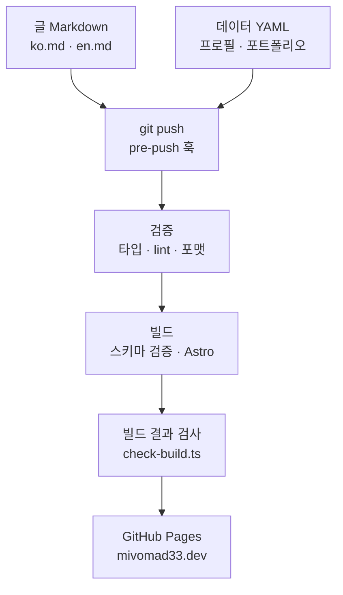

<div align="center">


<h1>mivomad33.dev</h1>

<p>프로필, 포트폴리오, 블로그를 담은 개인 사이트. 한국어와 영어로 제공합니다.</p>

[](https://github.com/mivomad33/mivomad33.github.io/actions/workflows/deploy.yml)
[](https://mivomad33.dev)
[](https://astro.build)
[](https://www.typescriptlang.org)
[](https://tailwindcss.com)
[](LICENSE)

[사이트](https://mivomad33.dev) · [주요 기능](#주요-기능) · [동작 방식](#동작-방식) · [빠른 시작](#빠른-시작) · [콘텐츠 넣기](#콘텐츠-넣기)

**한국어** | [English](README.en.md)

</div>

<p align="center">
  
</p>

## 소개

활동한 결과물(만든 프로젝트, 개발과 사업 기록)을 한곳에 남겨 두려고 만든 사이트입니다.
웹에서 글을 쓰는 CMS 없이, 저장소의 Markdown과 YAML 파일만 고쳐 push하면 검증과 빌드를 거쳐 GitHub Pages로 배포됩니다.

- 홈: 최근 포트폴리오와 최근 글
- 포트폴리오: 데이터 파일에 적은 프로젝트를 카드로 표시
- 블로그: 글 목록과 글 보기(이전 글·다음 글)
- 소개: 프로필과 연락처

## 주요 기능

- **두 언어**: 모든 페이지가 한국어(`/...`)와 영어(`/en/...`)로 만들어지고, 헤더의 `ko / en` 링크로 같은 페이지의 다른 언어로 갑니다. 글·포트폴리오·프로필에 한쪽 언어가 빠지면 빌드가 실패해 배포되지 않습니다.
- **파일로 쓰는 콘텐츠**: 글은 글 폴더에 `ko.md`·`en.md`를, 프로필·포트폴리오는 YAML 파일을 고칩니다. 형식은 스키마(Zod)로 검사해 필드가 빠지거나 오타가 있으면 빌드가 실패합니다.
- **검색 엔진 기본기**: 페이지마다 설명·canonical·OG·Twitter 메타 태그, 언어별 버전 링크(hreflang), 글의 구조화 데이터(`BlogPosting`), 언어별 OG 이미지, sitemap(언어 버전 포함), robots.txt가 있습니다.
- **빌드 결과 검사**: 빌드가 끝나면 스크립트가 만들어진 HTML을 모두 읽어 메타 태그, 언어 링크, sitemap, robots.txt, 외부 링크 표시가 규칙대로인지 확인합니다. 하나라도 틀리면 배포되지 않습니다.
- **외부 링크 표시**: 사이트 밖으로 가는 링크는 새 탭에서 열리고 아이콘과 화면 낭독기용 문구가 붙습니다. 글 본문의 Markdown 링크에도 같은 규칙을 적용합니다.
- **미니멀한 디자인**: 고정폭 글꼴의 기호·날짜와 초록 강조색을 쓴 개발자 모노형 디자인입니다. 데스크톱과 모바일에서 가로 스크롤이 없습니다.

## 화면

<table>
  <tr>
    <td width="64%"></td>
    <td width="36%"></td>
  </tr>
</table>

<p align="center">
  
  &nbsp;
  
</p>

## 동작 방식



1. 글이나 데이터 파일을 고쳐 push하면, 로컬의 `pre-push` 훅이 먼저 `pnpm verify`를 돌려 실패하면 push를 멈춥니다.
2. GitHub Actions가 검증(`pnpm check`) → 빌드(`pnpm build`) → 배포를 차례로 실행합니다. 앞 단계가 실패하면 다음 단계는 실행되지 않습니다.
3. 빌드는 콘텐츠 컬렉션 스키마로 글·데이터를 검사한 뒤 정적 HTML을 만들고, `scripts/check-build.ts`가 결과물을 검사합니다.
4. main 브랜치의 push만 GitHub Pages로 배포합니다. 다른 브랜치에서는 검증과 빌드만 합니다.

## 품질 관리

- `pnpm check`: 타입 검사(`astro check`), ESLint, Prettier 포맷 검사
- `pnpm build`: 빌드(스키마 검증 포함)와 빌드 결과 검사
- `pnpm verify`: 위 둘을 차례로 실행합니다. push 전 훅과 같은 명령입니다.
- 빌드 결과 검사가 보는 것: 페이지 종류별 메타 태그, 모든 페이지가 두 언어로 있는지, hreflang과 언어 전환 링크가 실제 페이지를 가리키는지, sitemap에 빠진 페이지가 없는지, robots.txt 규칙, OG 이미지 원본과 프로필 값이 같은지, 외부 링크 표시
- 패키지는 공개된 지 하루 이상 지난 버전만 설치합니다(pnpm의 `minimumReleaseAge`). 공개 직후의 악성 버전을 피하기 위해서입니다.

## 기술 스택

| 분류       | 사용                                                                 |
| ---------- | -------------------------------------------------------------------- |
| 프레임워크 | Astro 7(정적 출력), 콘텐츠 컬렉션                                    |
| 언어       | TypeScript 6                                                         |
| 스타일     | Tailwind CSS 4, Pretendard, JetBrains Mono                           |
| Markdown   | Astro 내장 처리기(Sätteri), Shiki 코드 하이라이팅                    |
| 검증       | Zod 스키마, `astro check`, ESLint, Prettier, 빌드 결과 검사 스크립트 |
| SEO        | `@astrojs/sitemap`, 직접 만든 robots.txt·메타 태그                   |
| 배포       | GitHub Actions, GitHub Pages(사용자 지정 도메인)                     |
| 도구       | pnpm 12, Node 24                                                     |

## 빠른 시작

준비물: Node 24.16 이상(`.nvmrc`), pnpm 12(`package.json`의 `packageManager`)

```sh
git clone https://github.com/mivomad33/mivomad33.github.io.git
cd mivomad33.github.io
pnpm install      # 의존성 설치와 push 전 훅 연결
pnpm dev          # 개발 서버
pnpm verify       # 검증과 빌드(push 전 훅과 같은 명령)
```

- `pnpm install`은 `prepare` 스크립트로 `.githooks/`를 Git 훅 폴더로 연결합니다. 이미 설치된 폴더라 `prepare`가 건너뛰어졌다면 `pnpm run prepare`를 한 번 실행합니다.
- 빌드 결과를 미리 보려면 `pnpm build` 뒤에 `pnpm preview`를 실행합니다.

## 콘텐츠 넣기

### 글

`src/content/blog/<slug>/`에 한국어 `ko.md`와 영어 `en.md`를 함께 넣습니다. 폴더 이름(slug)이 주소가 되며(`/blog/<slug>/`, `/en/blog/<slug>/`), 영문 소문자·숫자·하이픈으로 씁니다. 글에 넣는 이미지는 같은 폴더의 `images/`에 둡니다.

```md
---
title: '글 제목'
description: '목록과 검색 결과에 보일 한두 문장'
date: 2026-10-24
updated: 2026-10-30 # 선택, 크게 고쳤을 때만
---

<본문>
```

### 프로필과 포트폴리오

- `src/data/profile.yaml`: 활동명, 한 줄 소개, 이메일, 링크
- `src/data/portfolio.yaml`: 프로젝트마다 이름, 설명, 링크 목록. 파일에 적은 순서대로 보이므로 새 항목은 맨 위에 적습니다.

언어마다 다른 글자는 `ko`와 `en`을 모두 적습니다. 필드와 규칙은 [설계 문서의 데이터 파일 형식](docs/design.md#데이터-파일-형식)에 있습니다.

## 프로젝트 구조

<details>
<summary>주요 폴더 보기</summary>

```text
.
├── .github/              # 워크플로(검증·빌드·배포)와 README 이미지
├── .githooks/            # push 전 검증 훅
├── docs/                 # 기획·설계·진행 문서
├── public/               # 파비콘, OG 이미지
├── scripts/
│   └── check-build.ts    # 빌드 결과 검사
└── src/
    ├── components/       # 공통 UI 부품
    ├── content/blog/     # 블로그 글(<slug>/ko.md, en.md)
    ├── data/             # 프로필·포트폴리오 데이터
    ├── layouts/          # 공통 레이아웃
    ├── lib/              # 사이트 설정, 언어, 메타 태그, 콘텐츠 로더
    └── pages/            # 페이지(한국어·영어를 한 파일에서 만든다)
```

</details>

## 문서와 개발 과정

이 사이트는 [Claude Code](https://claude.com/claude-code)와 함께 만들었습니다. 코드를 쓰기 전에 기획과 설계를 문서로 정하고, 단계마다 문서를 기준으로 구현하고 검토했습니다. 화면을 바꾸는 작업은 구현 전에 HTML 시안을 만들어 확인을 받았습니다.

- [프로젝트 개요](docs/project_overview.md): 목표, 원칙, 범위
- [설계](docs/design.md): 기술 스택, 페이지와 URL, 데이터 형식, 코드 규칙, 테스트 전략, 공통 UI
- [진행 계획](docs/plan.md): 단계와 진행 상태. 단계마다의 결정과 이유는 `docs/stages/`에 있습니다.
- [변경 기록](docs/changes/): 개발을 마친 뒤의 변경(영어판 추가, 외부 링크 표시 등) 한 건씩

문서는 한국어로만 씁니다.

## 라이선스

코드는 [MIT 라이선스](LICENSE)를 따릅니다. 글, 이미지, 프로필·포트폴리오 내용(`src/content/`, `src/data/`, `src/assets/`, `public/`, `.github/assets/`)은 모든 권리를 보유합니다.
