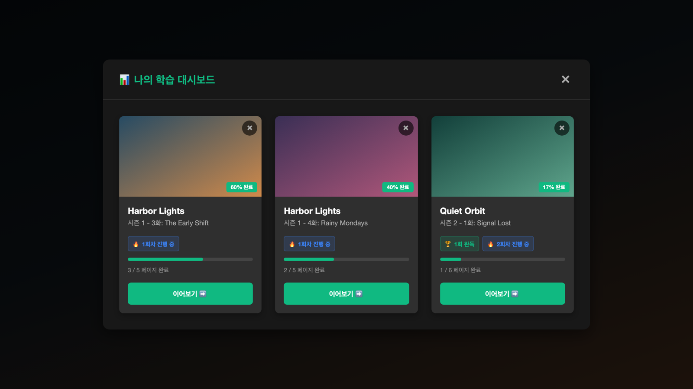

Netflix is great material for learning English. But it isn't a language learning platform, so using it to study is painful. Replaying a sentence, organizing a script and keeping track of how far you got all have to be done separately.

So I built the features I needed as a Chrome extension. It's called `netflix-subtitle-study`, and it adds a study panel next to the Netflix player. I still use it regularly.

## Turning a video into a script and pages

The extension takes the English and Korean subtitles of the playing video, matches them by time and builds a single script. That script is the textbook.

- The current sentence is highlighted and scrolled into view. Clicking a sentence plays from that point.
- The script is split into pages. You choose 20, 50, 100 or 150 lines per page.
- English and Korean subtitles can appear together over the video, and each language can be hidden.

Playback works in sentences too. It can loop one sentence endlessly, stop after every sentence or stop at the end of a page.

## Five steps per page, repeated in rounds

The unit of study is a page, not a video. Each page has five steps to check off.

1. Pre-study
2. Watching without subtitles
3. Working through the script
4. Shadowing
5. Writing practice

To study the same video again, you add a round. Each round keeps its own record.

Pre-study and writing practice use an AI chatbot. But the extension doesn't call any AI itself. A button copies a prompt containing the current page's script, and you paste it into a chatbot.

- Pre-study prompt: asks for the expressions, patterns and words to learn before watching.
- Writing prompt: asks for a short English dialogue based on the script, with the English and the Korean translation shown separately.

Studied videos are gathered in a tab added to the Netflix top menu. It shows progress and rounds, and you can pick up where you left off. Records are saved in the browser's `localStorage`.

## The feature I use most: skipping by subtitles and time

There are keys for moving sentence by sentence (`A`, `S`, `D`), but the ones I find hugely useful are `W` and `E`. They skip by looking at both subtitles and time.

- `E`: if the next line is less than 5 seconds away, it goes to that line. Otherwise it jumps 5 seconds ahead.
- `W`: if the previous line is less than 5 seconds back, it goes to that line. If the gap is 5 to 10 seconds, it goes back half of the gap. At 10 seconds or more, it goes back 5 seconds.

So where people are talking, no sentence gets skipped, and where nobody is talking, a few presses get you through. You can move quickly and watch only the parts you need.

When studying, this lets me see just the essentials and move on. But now I use it even when I'm simply watching something for fun. I can skip every boring part, still follow the entire story and get through it really fast.

There's also an automatic way to pass silent stretches. It can jump over any gap of 5 seconds or more without dialogue, or move 5 seconds at a time while previewing the picture for 2 seconds.

## Making it work inside Netflix

Netflix offers no official way to do any of this, so the extension runs its script inside the Netflix page.

- **Finding subtitles**: it wraps `JSON.parse` to catch the video manifest the player receives, then picks the English and Korean subtitle tracks and downloads them.
- **Matching the two languages**: the two sets of subtitles don't line up one to one. Pairs are found by how much their times overlap, and when one Korean subtitle spans several English ones, they're merged into one sentence.
- **Finding the current sentence**: `requestAnimationFrame` reads the player's time to find the current sentence. Looping, auto-stop and skipping are decided here as well.

It's built with Chrome Manifest V3, React 18, TypeScript and Webpack 5.

## Try it

- Code: [GitHub](https://github.com/mivomad33/netflix-subtitle-study)

It isn't on the Chrome Web Store, so you build it yourself and install it in developer mode. It only works on videos with both English and Korean subtitles, and the interface is in Korean. It isn't affiliated with or approved by Netflix, so please check the Netflix terms of use yourself.
