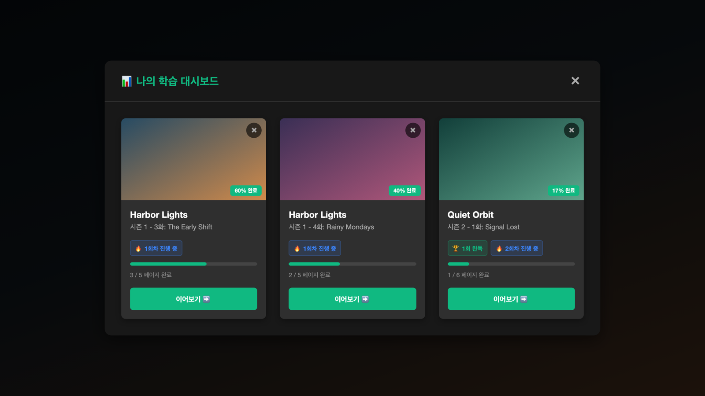

넷플릭스는 좋은 영어 학습 자료입니다. 다만 언어 학습 플랫폼이 아니다 보니 공부에 쓰기에는 너무 불편합니다. 문장을 다시 들으려 해도, 대본을 정리하려 해도, 어디까지 공부했는지 기록하려 해도 모두 따로 해야 합니다.

그래서 필요한 기능을 크롬 확장 프로그램으로 직접 만들었습니다. 이름은 `netflix-subtitle-study`이고, 넷플릭스 시청 화면 옆에 학습 패널을 붙입니다. 지금도 잘 쓰고 있습니다.

## 영상을 대본과 페이지로

재생 중인 영상의 영어 자막과 한국어 자막을 시간 기준으로 맞춰 하나의 대본으로 만듭니다. 이 대본이 교재입니다.

- 지금 재생 중인 문장을 강조하고 그 위치로 스크롤합니다. 문장을 누르면 그 지점부터 재생합니다.
- 대본은 페이지로 나눕니다. 페이지당 대사 수는 20, 50, 100, 150개 중에서 고릅니다.
- 영어와 한국어 자막을 영상 위에 함께 띄우고, 언어별로 숨길 수 있습니다.

재생도 문장 단위로 다룹니다. 한 문장을 끝없이 반복하거나, 문장마다 멈추거나, 페이지 끝에서 멈추게 할 수 있습니다.

## 페이지마다 다섯 단계, 회차마다 다시

공부의 단위는 영상이 아니라 페이지입니다. 페이지마다 다섯 단계를 체크합니다.

1. 사전 학습
2. 무자막 시청
3. 스크립트 해석
4. 쉐도잉
5. 영작 연습

같은 영상을 다시 공부할 때는 회차를 추가합니다. 회차마다 기록이 따로 남습니다.

사전 학습과 영작 연습에는 AI 챗봇을 씁니다. 다만 확장 프로그램이 AI를 직접 부르지는 않습니다. 버튼을 누르면 현재 페이지의 대본이 담긴 프롬프트가 복사되고, 그것을 챗봇에 붙여 넣습니다.

- 사전 학습 프롬프트: 영상을 보기 전에 익혀야 할 표현, 패턴, 단어를 정리해 달라고 합니다.
- 영작 프롬프트: 대본을 바탕으로 짧은 영어 대화를 만들고, 영어와 한국어 번역을 따로 보여 달라고 합니다.

공부한 영상은 넷플릭스 상단 메뉴에 더해진 탭에서 모아 봅니다. 진행률과 회차를 보고, 하던 곳부터 이어 볼 수 있습니다. 기록은 브라우저 `localStorage`에 저장합니다.

## 가장 많이 쓰는 기능: 자막과 시간으로 넘어가기

문장 단위로 옮겨 다니는 단축키(`A`, `S`, `D`)도 있지만, 제가 엄청 유용하게 쓰는 것은 단축키 `W`와 `E`입니다. 자막과 시간을 같이 보고 넘어갑니다.

- `E`: 다음 대사까지 5초 미만이면 다음 대사로 가고, 5초 이상 남았으면 5초 앞으로 갑니다.
- `W`: 이전 대사까지 5초 미만이면 이전 대사로 갑니다. 5초에서 10초 사이면 그 간격의 절반만 되돌아가고, 10초 이상이면 5초 뒤로 갑니다.

이렇게 하면 대사가 이어지는 곳에서는 문장을 건너뛰지 않고, 대사가 없는 곳에서는 몇 번만 눌러 지나갑니다. 필요한 부분만 빠르게 보면서 넘어갈 수 있습니다.

공부할 때는 엑기스만 보면서 넘어갈 수 있어 좋습니다. 그런데 이제는 그냥 콘텐츠를 감상할 때도 이 기능을 씁니다. 지루한 부분을 전부 넘기면서도 내용은 전부 파악하며, 정말 빠른 속도로 볼 수 있기 때문입니다.

대사 없는 구간을 자동으로 넘기는 기능도 있습니다. 5초 이상 대사가 없는 구간을 통째로 건너뛰거나, 5초씩 넘기며 2초간 화면을 미리 볼 수 있습니다.

## 넷플릭스 안에서 돌아가게 하기

넷플릭스는 이런 기능을 위한 공식 수단을 주지 않습니다. 그래서 확장 프로그램의 스크립트를 넷플릭스 페이지 안에 넣어 실행합니다.

- **자막 찾기**: `JSON.parse`를 감싸서 플레이어가 받는 영상 매니페스트를 찾습니다. 거기서 영어와 한국어 자막 트랙을 골라 내려받습니다.
- **두 언어 맞추기**: 두 자막은 줄이 일대일로 맞지 않습니다. 그래서 시간이 겹치는 정도로 짝을 찾고, 한국어 자막 하나가 영어 자막 여러 개에 걸리면 한 문장으로 묶습니다.
- **현재 문장 찾기**: `requestAnimationFrame`으로 플레이어의 재생 시간을 읽어 지금 문장을 찾습니다. 반복, 자동 멈춤, 건너뛰기도 여기서 판단합니다.

기술은 Chrome Manifest V3, React 18, TypeScript, Webpack 5입니다.

## 써 보기

- 코드: [GitHub](https://github.com/mivomad33/netflix-subtitle-study)

Chrome 웹 스토어에는 올리지 않아서, 직접 빌드해 개발자 모드로 설치합니다. 영어와 한국어 자막이 모두 있는 영상에서만 동작하고, 화면은 한국어입니다. 넷플릭스와 제휴하거나 넷플릭스가 승인한 프로젝트가 아니므로, 넷플릭스 이용 약관은 직접 확인해 주세요.
