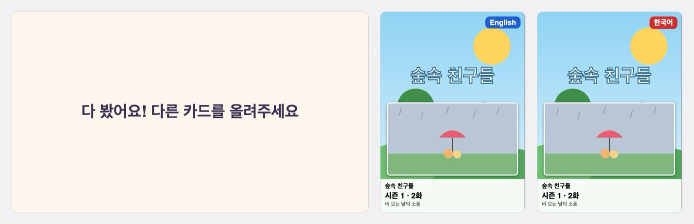

딸을 위해 만들었습니다. 넷플릭스와 디즈니 플러스에는 아이가 볼 영상이 셀 수 없이 많은데, 아이가 그 목록을 스크롤하며 고르는 모습이 마음에 들지 않았습니다. 화면 속 목록일 뿐 손에 쥘 실물이 없으니 "내 것"이라는 느낌도 없었습니다.

처음에는 DVD를 쓰려고 했습니다. 하지만 DVD는 이미 저물어 새 작품이 나오지 않고, 플레이어도 구하기 어려웠습니다. 그래서 DVD의 좋은 점만 OTT로 옮겼습니다. 영상마다 NFC 카드를 한 장씩 만들고, 아이는 보고 싶은 카드를 골라 리더기에 올리기만 합니다. 메뉴도, 추천 목록도, 다음 화 자동 재생도 없습니다.

## 이렇게 씁니다

- 카드를 올리면 그 영상이 전체화면으로 재생되고, 떼면 멈춥니다.
- 같은 카드를 다시 올리면 멈춘 곳부터 이어지고, 다른 카드를 올리면 그 영상으로 바뀝니다.
- 엔딩 크레딧까지 보면 대기 화면으로 돌아가 "다 봤어요! 다른 카드를 올려주세요"를 띄웁니다.
- 음성은 카드에 적힌 언어로 나오고, 자막은 항상 끕니다. 아이가 글을 읽지 못하니 켤 일이 없습니다.

카드(NTAG215)에는 `netflix:81387730:en`처럼 서비스, 영상 ID, 음성 언어 한 줄만 적힙니다. 부모는 바탕화면 아이콘을 더블클릭해 켜고 Alt+F4로 끕니다. 카드에 내용을 쓰는 도구와 카드 표지를 만드는 도구도 함께 만들었습니다.

## 한 편이 끝나면 끝

카드 한 장은 항상 영상 한 편입니다. 시리즈 전체를 가리키는 카드는 없고, 한 편이 끝나면 다음 화나 추천작으로 넘어가지 않습니다. 이것을 지키려고 정한 것들이 있습니다.

- **크레딧은 끝까지 봅니다.** 크레딧 동안 서비스가 띄우는 다음 화 안내는 프로그램이 닫습니다. 끝은 남은 시간이 아니라 영상의 끝 신호로 판단합니다. 끝나기 1초 전에 끝난 것으로 보면 크레딧의 마지막을 보지 못하기 때문입니다.
- **"마침" 상태를 따로 둡니다.** 영상이 끝나도 카드는 리더기 위에 그대로 있습니다. 이때 그냥 대기 상태로 가면 "카드가 올라가 있으니 재생"이 되어 같은 영상이 끝없이 반복됩니다. 그래서 "이 카드는 처리했으니 떼거나 바꿀 때까지 기다린다"는 상태를 두었습니다. 같은 영상을 또 보려면 카드를 뗐다가 다시 올립니다.
- **카드를 떼고 1초를 기다립니다.** 카드가 살짝 밀리거나 인식이 순간 끊겨도 영상이 멈췄다 재생됐다 하지 않게 하기 위해서입니다. 다 본 뒤에도 같은 유예를 둡니다. 없으면 인식이 잠깐 끊겼다 붙는 것만으로 다 본 영상이 처음부터 다시 재생됩니다.

디즈니 플러스에서는 하나가 더 필요했습니다. 방금 다 본 영상의 카드를 다시 올리면, 디즈니 플러스가 끝나기 5초쯤 전부터 이어서 재생해서 5초 만에 "다 봤어요"가 떴습니다. 아이가 "한 번 더" 보려고 카드를 다시 올리는 때가 바로 이때입니다. 그래서 카드를 올려 연 영상이 끝부분에서 시작하면 처음으로 되돌리게 했습니다.

## 아이를 서비스 화면에 남겨 두지 않기

없는 영상, 키즈 프로필에서 막힌 작품, 갑자기 뜬 프로필 선택 화면, 끊긴 인터넷. 아이는 이런 화면에서 할 수 있는 것이 없습니다. 그래서 원인을 따지지 않는 시간 제한을 두었습니다.

- 주소를 열고 20초 안에 재생되지 않으면 한 번 다시 열어 보고, 그래도 안 되면 대기 화면으로 돌아가 "이 카드는 지금 볼 수 없어요"를 띄웁니다.
- 재생 도중 30초 넘게 멈춰 있어도 같습니다.
- 로그인이 풀린 것을 알면 "부모님을 불러주세요"를 띄웁니다.

화면을 확인할 때는 이렇게 끝내는 판단을 가장 먼저 봅니다. 프로필을 고를 수 없거나 크레딧 안내가 닫히지 않는 화면을 먼저 처리하려 들면, 그 화면이 떠 있는 동안 시간 제한이 영영 검사되지 않기 때문입니다.

정지와 재생도 명령을 한 번 보내고 끝내지 않습니다. 1초마다 화면의 실제 상태를 읽고, 재생되어야 하는지 멈춰 있어야 하는지와 다르면 맞춥니다. 페이지가 열리는 중에 카드를 떼면 정지 명령이 영상이 생기기 전에 나가 효과가 없고, 그 뒤 영상이 로드되면 카드 없이 재생되기 때문입니다. 스페이스 키로 정지와 재생을 바꾸는 방식도 쓰지 않습니다. 토글이라 한 번 어긋나면 반대로 동작합니다.

## 공식 기능이 없어서, 실험부터

넷플릭스와 디즈니 플러스는 이런 조작을 위한 공식 기능을 주지 않습니다. 프로그램은 웹 화면과 사이트 안에서 쓰는 요청을 이용합니다. 그래서 설계는 처음에 "서비스가 이렇게 동작할 것"이라는 가정 위에 쓰였고, 그 가정은 하나도 확인되지 않은 상태였습니다.

그래서 구현 전에 확인 실험부터 했습니다. 첫 실험에서 14개 항목을 실제 넷플릭스로 확인했고, 가정과 달라 설계를 고친 것이 4개였습니다.

- 프로필 선택 화면은 주소가 목록 페이지와 같아서 주소로 구분할 수 없었습니다. 화면에 있는 요소로 구분하게 바꿨습니다.
- 없는 영상이나 막힌 작품은 오류 화면이 바로 떠서, 20초를 기다리지 않고 알아챌 수 있었습니다.
- 크레딧 안내는 닫을 수 있었습니다.
- 사용 중 로그인이 풀리면 로그인 페이지가 아니라 작품 소개 페이지로 넘어갔습니다.

화면을 알아볼 때는 "그 화면에만 있는 것이 보인다"로만 판단합니다. "다른 화면의 표시가 없으니 이 화면이다"로 판단하면, 페이지가 열리는 도중 아직 그려지지 않은 순간에 잘못 판단합니다.

리더기 실험에서는 실수도 했습니다. 카드 감지 설정을 읽는 명령인 줄 알고 보낸 것이 실제로는 설정을 바꾸는 명령이라, 리더기의 자동 카드 감지가 꺼졌습니다. 바로 되돌렸고, 그 뒤로 프로그램은 리더기 자체의 설정을 바꾸는 명령을 보내지 않습니다. 카드를 올릴 때 나는 삑 소리도 끄지 않았습니다. 아이에게 카드가 인식됐다는 신호가 되기 때문입니다.

## 그림으로 고르는 카드 표지

카드는 겉보기에 모두 같아서, 글을 읽지 못하는 아이는 어떤 영상의 카드인지 알 수 없습니다. 그래서 영상 주소를 넣으면 표지를 A4 인쇄용 PDF로 만드는 기능을 더했습니다. 표지는 카드와 함께 탑로더(카드 보관 케이스)에 넣습니다.

- 바탕은 작품의 세로 포스터이고, 시리즈의 화는 그 화의 장면 그림을 따로 넣습니다. 같은 시리즈라도 화마다 그림이 다르게 하기 위해서입니다.
- 영상마다 영어 표지와 한국어 표지를 한 장씩 만들고, 언어는 오른쪽 위에 색이 다른 표시로 넣습니다. 언어를 묻지 않는 대신, 카드를 어느 언어로 쓰든 맞는 표지가 있게 했습니다.
- 크기는 67×93mm이고 A4 한 장에 9장이 들어갑니다. 인쇄 배율을 재 볼 수 있게 100mm 눈금도 함께 인쇄합니다.
- 정보는 로그인된 Chrome 프로필로 서비스에 직접 물어 얻습니다. 처음에는 영상을 재생하는 동안 오가는 데이터에서 찾았는데, 재생해야 하고 시청 기록이 남을 수 있어서 재생 없이 묻는 방법으로 바꿨습니다.

PDF 안의 표지 크기는 맞는 것을 확인했지만, 실제로 인쇄해서 크기를 재 보지는 않았습니다.

## 만든 방식

- Python 3.13, Windows 10. 리더기는 ACR1252U이고, Windows 표준 스마트카드 방식(PC/SC)으로 `pyscard`를 써서 주고받습니다. 카드 메모리는 라이브러리 없이 리더기 명령으로 직접 읽고 씁니다. 카드에 텍스트 레코드 하나만 쓰므로 짧은 코드로 충분했습니다.
- 넷플릭스와 디즈니 플러스 재생에 필요한 DRM 때문에 설치된 Chrome을 씁니다. Playwright가 Chrome을 띄우면 DRM 모듈이 준비되지 않을 수 있어서, 프로그램이 Chrome을 직접 띄우고 Playwright로 붙어 조작만 합니다.
- 리더기 감시, 키보드 입력, 타이머는 이벤트 대기열 하나에 이벤트를 넣기만 하고, 상태 관리는 이벤트를 한 번에 하나씩 처리합니다. 그래서 여러 일이 동시에 일어나도 순서가 꼬이지 않고, 리더기 자리에 키보드로 흉내 내는 가짜 리더를 끼워도 나머지 코드는 그대로입니다.
- 자동 테스트(`pytest`)는 실제 리더기를 쓰지 않습니다. 리더기 위에 카드가 올라가 있는지에 따라 테스트 결과가 달라진 일이 있어서, 리더기 자리에는 실제 리더기로 확인한 Windows의 동작을 따르는 가짜를 끼웁니다. 넷플릭스와 디즈니 플러스는 흉내 낸 가짜 영상 사이트를 실제 Chrome에 띄워 확인합니다.

카드를 다시 올리고 영상이 이어지기까지 실제로 약 0.4초 걸립니다. 지금 딸은 이 카드들을 아주 좋아하고 잘 쓰고 있습니다. 표지를 넣은 카드는 정말 자기만의 영상 모음처럼 보입니다.

## 써 보기

- 코드: [GitHub](https://github.com/mivomad33/ott-card-player)

Windows용 프로그램이고, NFC 리더기와 카드, 각 서비스의 구독이 필요합니다. 넷플릭스, 디즈니 플러스와 관계없는 개인 프로젝트이고, 서비스가 화면을 바꾸면 동작하지 않을 수 있습니다. 표지에 들어가는 그림과 제목은 서비스의 것이므로 집에서 개인 용도로만 씁니다.
