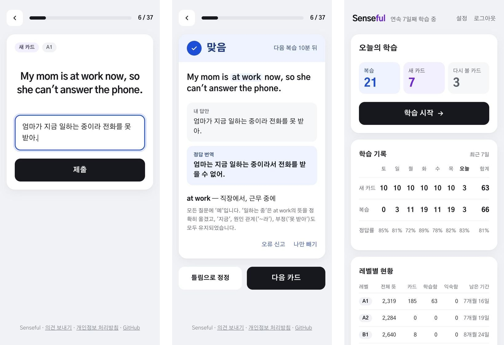

영단어를 Anki로 공부하다 두 가지가 계속 불편했습니다.

- 카드를 볼 때마다 Again, Hard, Good, Easy 중 하나를 직접 골라야 합니다.
- 단어, 뜻, 예문을 직접 찾아 입력해야 합니다.

그래서 문제를 풀기만 하면 되는 앱을 만들었습니다. 이름은 [Senseful](https://senseful.vercel.app)입니다. 단어를 뜻(sense) 하나씩 배운다는 뜻입니다.

## 이렇게 공부합니다

1. 영어 예문이 하나 나오면 한국어로 번역해 입력합니다.
2. Claude가 맞음·틀림을 판정하고, 정답 번역과 판정 이유를 보여 줍니다. 판정이 아쉬우면 바로 정정할 수 있습니다.
3. 최종 판정으로 다음 복습 날짜가 정해집니다.

무엇을 배울지, 맞았는지, 언제 다시 볼지는 모두 앱이 정합니다. 제가 하는 일은 번역뿐입니다.

## 뜻 하나가 카드 하나

`run`의 "달리다"와 "(사업체를) 운영하다"는 서로 다른 카드입니다. 단어 하나를 카드 하나로 만들면 쉬운 뜻만 알아도 그 단어를 안다고 넘어가게 되기 때문입니다. 뜻마다 난이도도 달라서, 카드는 쉬운 레벨(A1)의 뜻부터 나옵니다. 지금 A1부터 C1까지 약 13,500개의 뜻이 있습니다.

## Claude에게 맡기지 않은 것: 뜻 고르기와 레벨

처음에는 단어와 레벨을 주면 Claude가 그 레벨까지의 뜻을 모두 뽑아 카드를 만들게 하려 했습니다. 만들기 전에 검증해 보니 꼭 있어야 할 뜻의 87%만 나왔고, A1 레벨에서는 67%였습니다. Claude는 뜻별 공식 레벨을 모르기 때문에, 뜻을 빠뜨리면서 동시에 레벨이 넘는 뜻을 섞었습니다.

그래서 일을 나눴습니다.

- 뜻 목록과 레벨은 사전의 공식 CEFR 표시를 기준으로 미리 정해 둡니다.
- Claude는 뜻마다 한국어 뜻, 영어 예문, 예문 번역만 만듭니다.

기준도 정했습니다. 뜻이 조금 빠지는 것은 감수하지만, 틀린 내용을 외우게 하는 것은 안 됩니다. 186장의 검증 세트를 여러 모델로 만들어 보고, 오류 지적이 없으면서 어색한 예문도 가장 적었던 Opus를 골랐습니다.

## 판정 기준은 제가 정했습니다

번역이 맞았는지는 "의미가 같으면 맞음"으로 정했습니다. 어순이나 말투가 달라도 뜻이 같으면 맞음이고, 대상 단어만 맞고 나머지 뜻이 다르면 틀림입니다.

이 기준을 Claude가 제대로 따르는지 보려고 답안 47개를 만들었습니다. 답안 초안은 Claude가 쓰고, 맞음·틀림 레이블은 제가 직접 붙였습니다. 레이블까지 Claude가 붙이면 판정하는 모델과 같은 쪽으로 치우쳐서, 제 기준과 어긋나는 곳을 잡을 수 없기 때문입니다. 실제로 붙여 보니 제 기준이 초안보다 엄격했습니다. "작은", "대략" 같은 수식어를 빠뜨린 번역이나 시제가 다른 번역은 틀림으로, 오타는 맞음으로 봤습니다.

통과 기준은 틀리는 방향마다 따로 두었습니다.

- 틀린 답을 맞음으로 판정: 0건. 맞았다고 하면 다시 확인하지 않아서 잘못 외우게 됩니다.
- 맞은 답을 틀림으로 판정: 2건 이하. 정정 버튼으로 메울 수 있습니다.

모델마다 세 번씩 돌렸고, Opus는 세 번 모두 틀린 답을 맞음으로 판정한 것이 0건, 맞은 답을 틀림으로 판정한 것이 1건이었습니다. 판정 한 번에 1.4센트 정도입니다. 저장된 정답 번역과 똑같이 쓴 답은 API를 부르지 않고 맞음으로 처리합니다.

같은 47개를 보며 프롬프트를 고쳤으니 이 세트에 맞춰졌을 수 있습니다. 판정을 정정한 기록을 모두 남겨 두고, 실제로 쓰면서 확인하고 있습니다.

## 버튼 두 개로 쓰는 FSRS

복습 일정은 간격 반복 알고리즘 FSRS(`ts-fsrs`)가 정합니다. Anki에도 들어 있는 알고리즘인데, 등급은 두 개만 씁니다. 맞음은 Good, 틀림은 Again입니다. 맞히면 간격이 늘어나고, 틀리면 몇 분 뒤 다시 나옵니다.

하나 더한 규칙이 있습니다. 같은 단어의 다른 뜻 카드는 같은 날 연달아 나오지 않게 미룹니다. 앞 카드의 예문이 다음 카드의 정답을 알려 주는 일을 막기 위해서입니다.

## 혼자 쓰다가 공개하기까지

처음에는 제 맥에서만 도는 앱이었습니다. 로그인도 없고, 로컬 DB에, Dock 아이콘을 누르면 서버가 켜졌습니다. 며칠 매일 써 보니 휴대폰에서도 하고 싶어져서, 구글로 로그인하는 웹앱으로 바꿔 공개했습니다.

- Next.js 16, Neon Postgres, Drizzle ORM, Vercel
- 카드는 모두 같이 쓰고, 학습 기록은 사람마다 따로 둡니다.
- 고정비는 0원입니다. Claude API 비용은 하루 판정 횟수에 한도를 두어 막습니다.

개발은 Claude Code로 했습니다. 결정할 때마다 이유를 문서에 남기고, 큰 작업은 명세서를 먼저 써서 Claude가 끝까지 구현하게 했습니다. 위의 검증들도 그 과정에서 만든 것입니다.

## 써 보기

- 사이트: [senseful.vercel.app](https://senseful.vercel.app)
- 코드: [GitHub](https://github.com/mivomad33/senseful)

화면은 한국어이고, 하루 판정 횟수에 한도가 있는 베타입니다.
