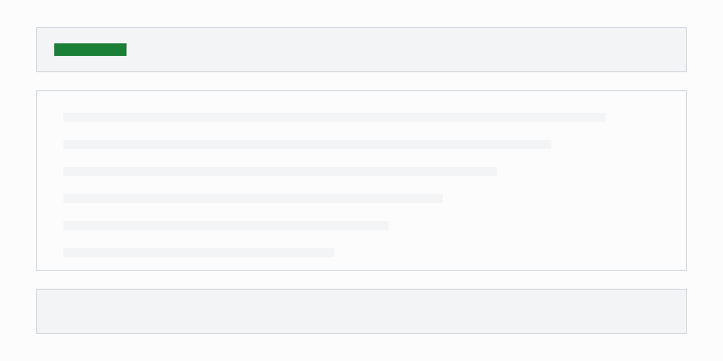

이 사이트는 [Astro](https://astro.build)로 만든 정적 사이트다. 처음부터 코드를 쓰지 않고, 기술 스택과 공통 설계를 문서로 먼저 정했다. 이 글은 그 과정에서 무엇을 왜 정했는지 정리한다.

## 왜 정적 사이트인가

글과 포트폴리오는 자주 바뀌지 않는다. 서버를 따로 운영할 이유가 없어서 md 파일을 빌드해 `GitHub Pages`로 배포하기로 했다.

- 운영 비용이 들지 않는다.
- 글을 md 파일로 관리하므로 버전 관리가 그대로 된다.
- 빌드할 때 데이터 형식을 검사해, 틀린 글이 배포되지 않게 할 수 있다.

페이지는 헤더, 본문, 푸터 세 부분으로 나눴다.



### 단계를 나눈 방법

1. 기술 스택을 정한다.
2. 페이지 구성과 데이터 형식을 정한다.
3. 디자인 시안을 고른다.

단계별 진행 상태는 아래와 같다. 넓은 표는 좁은 화면에서 표 안에서만 가로로 스크롤된다.

| 단계 | 내용 | 상태 | 확인 방법 |
| --- | --- | --- | --- |
| 1 | 기술 스택 선정 | `완료` | 결정과 이유가 설계 문서에 있다 |
| 2 | 공통 설계(페이지 구성, URL, 데이터 형식, 디렉터리 구조) | `완료` | 사용자 검토를 통과했다 |
| 6 | 블로그 | 진행 중 | md 파일을 추가하면 목록과 글 보기에 반영된다 |

> 공개 뒤에 주소를 바꾸면 검색 노출이 나빠진다. 그래서 URL 구조는 구현 전에 정했다.

---

날짜는 시간대에 따라 하루 밀리지 않게 UTC 기준으로 표시한다.

```ts
export function formatDate(date: Date): string {
  // 글의 날짜는 UTC 자정이므로 UTC 기준으로 꺼낸다. 이 줄은 코드 블록 안에서 가로 스크롤이 생기는지 보기 위해 일부러 길게 쓴 주석이다.
  return date.toISOString().slice(0, 10);
}
```

아주 긴 주소도 화면 밖으로 넘치지 않아야 한다: https://example.com/a/very/long/path/that/should/wrap/inside/the/content/area
