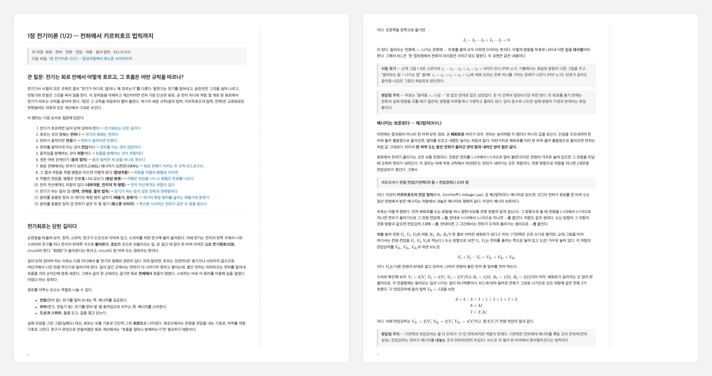

전기기사 필기 수험서는 대부분 요약집입니다. 공식은 나열되어 있지만, 그 공식이 어디서 왜 나왔는지, 개념이 서로 어떻게 이어지는지는 설명하지 않습니다. 저는 이해 없이 외우는 것을 싫어합니다. 그렇게 외운 것은 오래가지도 않습니다.

그래서 교재 챕터 PDF 하나를 넣으면 그 챕터를 처음부터 새로 쓴 **이해 노트**로 만드는 작업 환경을 만들었습니다. 노트는 Claude Code 스킬 `/chapter-note`가 쓰고, 교재 PDF를 다루는 일은 Python·Node 스크립트가 맡습니다.

## 노트는 이렇게 생겼습니다

위 화면은 그림 넣기 규칙이 생기기 전에 쓴 1장 노트를, 오른쪽에 필기 여백을 둔 PDF로 만든 것입니다.

- 챕터가 답하려는 **큰 질문** 하나로 시작합니다. 1장은 "전기는 회로 안에서 어떻게 흐르고, 그 흐름은 어떤 규칙을 따르나?"입니다.
- 이어서 그 질문에 답해 가는 순서(이야기 뼈대)를 목차처럼 보여 줍니다. 본문은 마디마다 앞 마디가 남긴 질문에 답하며 나아가고, 목록이 아니라 문단으로 씁니다.
- 공식은 필요해지는 자리에서 생략 없이 유도합니다. 유도할 수 없는 것은 사람이 정한 정의인지, 실험으로 얻은 측정값인지 밝힙니다.
- 공식이 아닌 원리·규칙(예: 전압계는 병렬, 전류계는 직렬)도 "왜"와 함께 다룹니다.
- 막히기 쉬운 곳은 그 자리에서 **헷갈림 주의**로 짚고, 교재·시험이 다른 형태나 기호로 쓰는 곳은 **시험 표기**로 연결합니다.
- 본문 뒤 부록에는 복습용 정리, 교재 범위 대응표, 스스로 설명해 보기 질문, 다른 챕터와의 연결이 있습니다.

## 교재를 고쳐 쓰다가, 새로 쓰기로

처음 지침은 교재를 다시 짜면서 공식을 유도하는 노트였습니다. 이 지침이 첫날 하루 동안 크게 네 번 바뀌었습니다.

1. **공식 목록에서 이야기로.** 공식 목록에 유도를 덧붙인 형태라 설명이 뚝뚝 끊기고, 공식이 아닌 원리·규칙이 들어갈 자리가 없었습니다. 그래서 큰 질문과 이야기 뼈대를 따라 문단으로 이어 쓰는 구조로 바꾸고, 본문(처음 읽는 글)과 부록(복습용)을 나눴습니다.
2. **교재 순서에서 논리 순서로.** 교재 순서를 기본값으로 삼지 않고, 개념을 모두 꺼내 놓고 순서를 처음부터 짜게 했습니다. 기준은 선수 관계가 먼저이고, 그다음 원리에서 응용, 단순한 것에서 복잡한 것입니다. 결과가 교재와 같아도 되고, 바꾸기 위해 바꾸지는 않습니다.
3. **교재가 생략한 것은 노트가 채운다.** 배경지식, 중간 단계, 이유를 노트가 직접 설명하게 했습니다. 이것을 노트의 핵심 가치로 봤습니다. 다만 범위 밖 내용은 이해에 필요한 만큼만 씁니다.
4. **교재는 기준이 아니다.** 여기까지 오니 노트는 교재를 재구성한 것이 아니라, 그 챕터 범위를 처음부터 새로 쓴 교재가 됐습니다. 그래서 교재의 역할을 두 가지로 줄였습니다.
   - 범위: 이 챕터에서 무엇을 빠짐없이 다뤄야 하는지
   - 시험 표기: 시험에 나오는 공식의 형태·기호·용어. 노트로 이해했는데 시험지에서 못 알아보는 일이 없게 하기 위해서입니다.

내용, 순서, 설명 방식, 기호는 모두 노트가 정합니다. 교재 문장도 옮기지 않습니다.

## AI가 쓴 노트를 어떻게 믿을까

교재를 기준으로 두지 않으면, 노트가 맞는지 교재와 대조해 확인할 수 없습니다. 그래서 정확성을 지키는 장치를 따로 뒀습니다.

- **확신이 없는 내용은 넣지 않는다.** 노트 내용은 일반적으로 확립된 물리·전기 지식에 맞아야 합니다.
- **맥락 없는 새 에이전트가 검증한다.** 범위 추출, 파트 검증, 챕터 전체 검토를 작업 맥락이 없는 새 에이전트에게 맡깁니다. 쓴 쪽의 착각이 그대로 넘어가지 않게 하기 위해서입니다. 파트 검증 에이전트는 유도 단계와 수치 예시를 직접 다시 계산합니다.
- **지적만 하고, 반영하지 않은 지적도 보고한다.** 에이전트는 노트를 직접 고치지 않고 지적 목록만 돌려줍니다. 고칠지는 쓴 쪽이 정하지만, 반영하지 않은 지적은 이유와 함께 최종 보고에 넣습니다. 작성자가 혼자 기각하면 별도 검증을 둔 의미가 없어지기 때문입니다.
- **교재와 닿는 곳은 두 번 본다.** 노트는 교재가 아니라 교재에서 뽑은 범위 목록을 보고 씁니다. 그래서 범위 목록은 교재와 직접 닿는 유일한 산출물입니다. 범위 목록을 교재 텍스트와 대조해 빠진 절·용어가 없는지 보고, 시험 표기는 범위 목록만 믿지 않고 교재 쪽 이미지와 직접 대조합니다. 범위를 뽑을 때 첨자 하나를 잘못 읽으면 그 오류가 노트까지 내려오기 때문입니다.
- **교재는 이미지로 읽는다.** 교재 PDF의 텍스트에서는 수식이 대부분 깨집니다. 그래서 텍스트는 구조 파악과 교차 검증에만 쓰고, 본문 쪽은 모두 이미지로 읽습니다.

작업은 범위 추출 → 설계 → 집필 → 마무리 네 단계입니다. 사람이 확인하는 곳은 설계 단계 한 번입니다. 큰 질문과 이야기 뼈대를 확인받는데, 뼈대가 틀리면 노트 전체를 다시 써야 하기 때문입니다. 그 뒤로는 파트마다 묻지 않고 끝까지 이어 씁니다.

챕터는 교재 본문 10~15쪽 정도의 파트로 나눠 씁니다. 한꺼번에 쓰면 앞쪽 세부가 흐려지고, 마지막에 몰아서 하는 검증이 형식적이 되기 때문입니다.

## 매번 판단할 필요가 없는 일은 스크립트로

기출 문제지 생성기를 만들 때 정한 원칙은 "AI가 매번 판단하지 않는다"입니다. 같은 입력에서 항상 같은 결과를 내는 규칙 기반 스크립트가 일하고, Claude는 스크립트를 처음 만들고, 결과를 검증하고, 예외가 나오면 고칠 때만 관여합니다. PDF를 다루는 도구 네 개가 이렇게 만들어졌습니다.

- `split-textbook`: 교재 원본 다섯 권(여섯 과목)을 챕터 PDF 54개로 자릅니다. PDF에 책갈피가 없어서, 채도 있는 한 색이 쪽의 절반 이상을 덮는 표지 쪽으로 챕터 경계를 찾습니다.
- `exam-sheets`: 교재의 기출 문제는 문제 바로 아래에 해설과 정답이 붙어 있어 스스로 풀어 볼 수 없습니다. 그래서 해설 상자와 정답을 가린 문제지와, 정답표가 붙은 해설 PDF를 만듭니다. 문제지는 이미지로 다시 만든 PDF라 가린 내용이 텍스트로도 남지 않습니다. 해설 상자 색이 책마다 달라 처음에는 네 과목에서 문제를 하나도 찾지 못했고, 정답 표시 바로 위 상자의 색으로 장마다 정하게 고쳤습니다.
- `textbook-figures`: 교재 그림을 잘라 노트에 넣습니다. 그림이 이미지가 아니라 벡터 도형이라, 캡션, 그림 라벨의 글꼴(바탕체)과 글자 크기, 표 칸선 같은 신호로 영역을 정합니다. 그림은 모두 넣기로 했습니다. 고르는 기준을 두면 빠지는 그림이 생기고, 다 넣는 편이 단순하기 때문입니다. 과목별 에이전트가 점검 이미지를 모두 보는 점검을 세 번 했고, 지적은 약 130건 → 95건 → 45건으로 줄었습니다. 남은 것은 `manual.json`에 좌표로 고쳤습니다.
- `note-pdf`: 노트와 기출 문제지를 오른쪽에 필기 여백이 넓은 챕터 PDF 한 권으로 묶습니다. 아이패드 필기 앱에서 쓰기 위한 것이고, 목차 책갈피와 노트 안 링크가 PDF 안에서 동작합니다.

## 공개 저장소에 교재를 넣지 않는다

교재는 저작물이고, 쪽마다 구매자 정보가 인쇄되어 있습니다. 그래서 저장소는 공개하되 교재에서 만든 것은 하나도 올리지 않습니다.

- 교재 PDF, 쪽 렌더링 이미지, 잘라 낸 그림, 기출 문제지는 모두 git에서 뺍니다. 저장소에는 도구, 스킬, 규칙 문서만 있습니다. 그림을 손으로 고친 `manual.json`은 좌표와 id뿐이라 올립니다.
- 도구는 로그와 결과 파일에 교재 본문을 출력하지 않습니다. 그림 추출 도구는 잘라 낼 영역에 구매자 정보로 보이는 글자가 있으면 멈춥니다.
- 노트는 교재 문장을 옮기지 않고 모두 새로 씁니다.

## 만든 방식과 기술

규칙은 두 곳에 나눠 뒀습니다. 노트가 **어떤 모습이어야 하는지**는 `CLAUDE.md`에, **어떻게 만드는지**는 스킬 파일에 있습니다. `CLAUDE.md`는 세션마다 읽히므로, 노트를 쓸 때만 필요한 절차는 스킬로 옮겼습니다.

- 노트 작성: Claude Code 스킬
- PDF 처리: Python(`uv`, PyMuPDF), Poppler
- 필기용 PDF: Node(markdown-it, KaTeX), 설치된 Chrome으로 PDF 출력
- 노트 형식: 마크다운과 KaTeX 수식. VS Code 미리보기로 열면 수식이 보입니다.

도구들은 다산에듀 「속전속결」 전기기사 필기 이론서의 편집 양식에 맞춰져 있습니다. 출판사와 관계없는 개인 학습용 비공식 프로젝트입니다.

## 코드

- [GitHub](https://github.com/mivomad33/electrical-engineer-understanding-notes-generator) (MIT 라이선스)

쓰려면 교재 PDF를 직접 구매해야 하고, 노트는 한국어로 쓰입니다.
