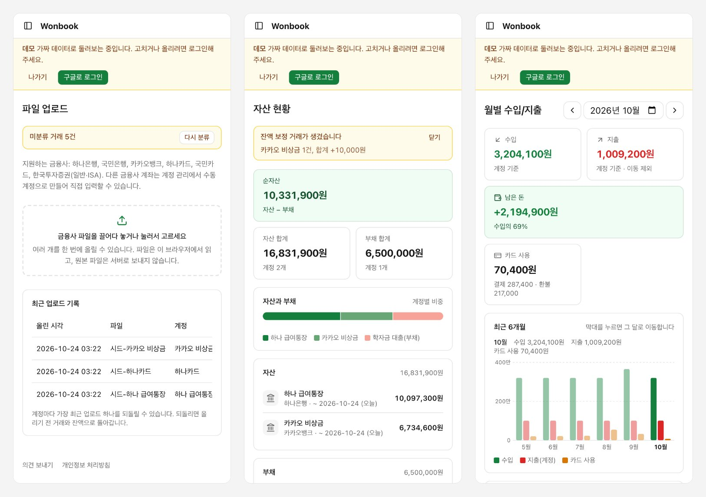

The budgeting service I had used for years had one big annoyance: I had to type in and tidy up every transaction from my banks and cards by hand. I also didn't see why I should keep paying a subscription for that.

So I built a budgeting app where all I do is upload files. It's called [Wonbook](https://wonbook.vercel.app).

## How you use it

1. Download your transaction history files (xls, xlsx or html) from your bank, card or brokerage website.
2. Drag them into Wonbook. You can upload several files at once.
3. Entering transactions, removing duplicates, categorizing and matching balances all happen automatically.

Right now it reads files from Hana Bank, KB Kookmin Bank, KakaoBank, Hana Card, KB Kookmin Card and Korea Investment & Securities, the Korean banks and companies I use.

## Treating the file as the truth instead of matching transactions

If I had to remember how far I'd uploaded last time, it wouldn't be much better than typing things in. So uploading an overlapping period must never create duplicates.

The obvious approach is to compare transactions one by one and skip the ones that already exist. But if you pay the same amount at the same shop twice on the same day, there's no way to be sure whether a transaction is new or already there.

So I decided not to compare at all. An uploaded file is treated as the truth for that account over that period: every existing transaction in the period is deleted and replaced with the file's contents.

- At first, the period ran from the earliest to the latest transaction date in the file. While building it, I switched to the query period printed at the top of the file. If a transaction I'd uploaded before was later canceled by the bank, its date could fall outside the earliest-to-latest range and never get removed. With the query period, even a file with no transactions becomes a valid answer: "nothing happened in this period."
- I'm asked to confirm only when transactions I've touched (added, edited or deleted myself) would be removed. Otherwise the period is replaced without a prompt.
- Transactions I delete myself are only marked as deleted, not actually removed. If they were removed, uploading an overlapping period would silently bring them back.
- Because replacing a period really deletes transactions, each account can undo its most recent upload.

## Not looking for transfers

Money sent from Hana Bank to Kookmin Bank is really a transfer. But every transaction that comes in from a file is classified only as income or spending. It's recorded as spending at Hana and income at Kookmin, and the two are never paired or netted against each other.

At first I accepted that income and spending would look inflated. But when I designed the monthly screen, I saw that counting card bill payments as spending counts the same money twice alongside card purchases, and moving money between my own accounts shows up as both income and spending. Totals like that can't tell you how much you earned and spent this month. So I left the transactions as they are, and only the "transfers" group of categories (card bills, moves between my accounts and pay apps, personal transfers) is taken out of the monthly totals and shown separately.

For the same reason, I kept a few other things simple.

- Card transactions are supporting data that never change your assets. The real money leaves when the bank pays the card bill.
- For brokerage accounts, I don't track valuations or buys and sells, only money moving in and out.
- That makes the balance calculated from recorded transactions drift from the real one. Bank and brokerage files include the balance after each transaction, so the app adds an adjustment for the difference and tells you (the notice in the middle screen above).

## Claude categorizes, and each merchant only once

With rules, every new merchant would need me to categorize it. So categories come from the Claude API.

- A cleaned-up version of the transaction text is the key, and once a key has a category it's saved and never asked again. When I correct a category, the correction sticks for that merchant too.
- Claude only gets the transaction text, whether money came in or went out, the payment method and the account type. Amounts, dates, memos and account numbers are never sent.
- Uploading the first year gives about 400 unique keys, so I estimated about $0.40 even with the most expensive model (Opus), and about $0.05 a month after that. At that price there's no reason to give up accuracy, so I use Opus.
- There are 25 categories. I compared three category sets and found that corrections come from fuzzy boundaries rather than the number of categories, so I picked the one that splits categories by what you buy. When I add a category later, the app offers to reclassify only the transactions that ended up in "Other."

## From a private tool to a public app

It started as an app that ran only on my Mac, with no login and no deployment. Then I turned it into a web app anyone can sign up for with Google. Since it would now hold other people's accounts and transactions, I rethought a few things.

- Bank files are read in the browser, and only the parsed transactions go to the server. Original files never reach the server, and uploads stay under the hosting request size limit (4.5 MB).
- For account numbers, only a hash (to match files to accounts) and the last four digits (for display) are stored. Long digit sequences in transaction text are also masked before they're sent to the server.
- As the admin, I only see the number of sign-ups and categorization usage. No screen shows anyone else's transactions or amounts.
- There's a read-only demo where you can browse every screen with fake data, without logging in.

It's built with Next.js 16, Neon Postgres, Drizzle ORM and Vercel. Fixed costs are zero, and a daily categorization limit caps the Claude API bill.

I built it with Claude Code. I wrote down the reason for every decision, and for big changes I wrote a spec first and had Claude implement it to the end.

## Try it

- Site: [wonbook.vercel.app](https://wonbook.vercel.app)
- Demo (no login): [wonbook.vercel.app/demo](https://wonbook.vercel.app/demo)
- Code: [GitHub](https://github.com/mivomad33/wonbook)

The app is in Korean and only reads files from the Korean banks above. Accounts at other banks can be added as manual accounts and entered by hand.
